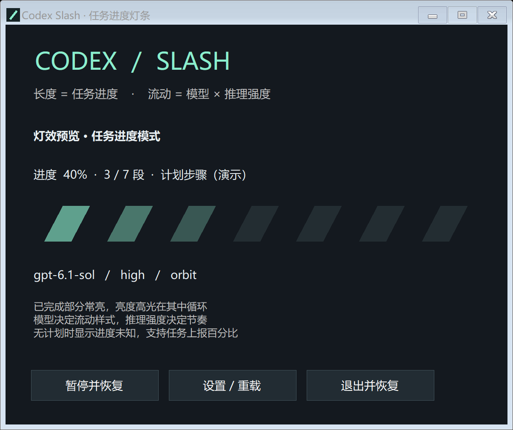

# Codex Slash

**Turn the Slash Lighting bar on your ROG Zephyrus into a Codex task progress indicator.**

[简体中文](README.zh-CN.md) · [Integration](INTEGRATION.md) · [Test results](TEST-RESULTS.md)



## What it does

- Progress controls the illuminated length: 10% lights one segment, 20% two, and 100% all seven.
- Completed segments stay lit while a highlight circulates inside the completed region.
- Model-specific animation styles and reasoning-effort-specific animation speeds.
- Optional CPU/GPU load modulation changes animation speed, never task completion percentage.
- Runs in the Windows tray alongside G-Helper and restores the previous lighting when released.
- Saves a recovery journal before takeover; a separate watchdog restores lighting after a process crash.

## Requirements and download

Windows x64 with **.NET 10 Windows Desktop Runtime**. Only the dedicated ASUS `0B05:193B`, `COL04`, 128-byte report `0x5E`, seven-segment Slash controller is supported in this version. Tested on **ROG Zephyrus G14 GA403UV** with G-Helper 0.285.

35-segment bars, AniMe Matrix and newer keyboard-multiplexed `19B6` interfaces are not supported. Device detection rejects those interfaces.

Download the Windows ZIP from this repository's Releases, extract the whole folder, and run `CodexSlash.exe`. Keep `settings.json` beside it. Closing the window leaves the tray application running; choose **退出并恢复 G-Helper** to exit and restore lighting. Login startup is optional and disabled by default.

The executable is unsigned and does not bundle the .NET runtime. It does not normally require administrator rights.

## Honest progress

The app follows local Codex session JSONL records for model, effort and task lifecycle. If structured plan updates are present, progress is completed steps divided by total steps. Explicit task reports take precedence:

```powershell
& '.\CodexSlash.exe' --progress 40
# Explicit targeting for concurrent chats:
& '.\CodexSlash.exe' --progress 40 --thread 'THREAD_UUID' --turn 'TURN_ID'
```

Without progress data, the app displays **unknown progress** with a single-segment idle indicator. It does not manufacture percentages from elapsed time, tool calls, tokens or CPU activity. A successful task-completion event shows 100% briefly. A new turn resets progress.

Codex's on-disk JSONL schema is an implementation detail and may change. Not every task emits structured plans. See [integration instructions](INTEGRATION.md) for milestone reporting. With multiple active chats, the most recently active primary task is selected; set `ThreadId` in `settings.json` to pin one chat.

## G-Helper coexistence

The app reads G-Helper settings without editing its configuration. It respects disabled lighting and battery-off preferences and leaves lid, boot and sleep firmware settings unchanged. G-Helper's continuously streamed audio/battery effects retain ownership; select an ordinary firmware effect to use Codex Slash.

Previous controller configuration is restored on pause, exit, Codex process exit, lock or suspend. Recovery cannot run while the machine is powered off; a retained journal is retried on the next launch. Physical lid-close and power-loss scenarios have not been tested.

No network service, API key or Codex hook installation is required. The app parses local session events without exporting conversation text. Runtime state and logs live under `%LOCALAPPDATA%\CodexSlash`.

## Configure and build

Edit `settings.json`, then choose **重载设置** in the tray menu. `ModelEffects` selects `orbit`, `reverse`, `bounce`, `twin`, `wave` or `pulse`. `EffortSpeeds` maps reasoning-effort names to animation speeds. See [Chinese documentation](README.zh-CN.md) for all settings.

Build with the .NET 10 SDK:

```powershell
.\build.ps1
$test = Start-Process .\CodexSlash.exe -ArgumentList '--self-test', "$env:TEMP\codex-slash-test.json" -Wait -PassThru
Get-Content "$env:TEMP\codex-slash-test.json"
```

There are no third-party NuGet dependencies. Build output is a framework-dependent Windows x64 single-file executable. Run hardware-writing tests only on supported devices; ordinary self-tests and diagnostics do not change lighting.

## Related work and scope

[Slashlight](https://github.com/gouthamk16/slashlight) is a broader Slash animation editor/controller with system and media meters. [CodexGlow](https://github.com/chaolie/CodexGlow) maps Codex events to keyboard RGB. [codex-lamp](https://github.com/loopbrew/codex-lamp) drives a Moonside lamp from Codex hooks.

Codex Slash focuses on seven-segment task completion, model/effort animation mapping and G-Helper restoration on Windows. These are related projects; this project makes no claim to be the first agent-controlled status light. See [research notes](RELATED-PROJECTS.md).

## License and attribution

GPL-3.0. ASUS Slash protocol sequences were adapted from [G-Helper](https://github.com/seerge/g-helper); see [third-party notices](THIRD-PARTY-NOTICES.md). This is an independent companion utility and is not affiliated with ASUS, G-Helper or OpenAI.
